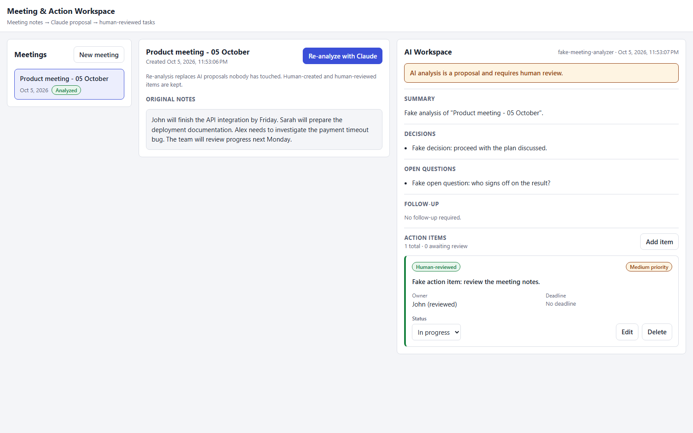

# Meeting & Action Workspace

Claude Portfolio Project 05. A small full-stack application that turns unstructured meeting
notes into a structured, human-reviewed workspace:

**meeting notes → Claude analysis → structured workspace → human review → owned, tracked tasks**

Claude proposes a summary, decisions, open questions and action items. People accept, edit,
re-own, track or delete those items. The application always shows which parts are an AI proposal
and which are a human decision.



*`docs/workspace.png` — the workspace running with the deterministic fake analyzer (the model label
reads `fake-meeting-analyzer`). It is not a live Claude result.*

## Verification status

Read this before relying on anything below:

- **Local verification is complete.** Backend build/lint, 43 unit tests, 62 e2e tests, frontend 6 tests and production build all pass.
- **Docker verification is complete.** Compose config passes; frontend, backend and migration images build; the full stack starts with the fake analyzer; a smoke flow creates a meeting, analyzes it, applies a human edit, reloads persisted state, and the frontend responds HTTP 200.
- **Live Anthropic validation is not yet verified.** The adapter exists and is unit-tested with a stubbed SDK client, but no real API call has been made because no `ANTHROPIC_API_KEY` is configured.
- **GitHub Actions are intentionally not used for this portfolio project.** Verification is local to avoid CI credit usage.

[`PORTFOLIO_STATUS.md`](PORTFOLIO_STATUS.md) tracks every completion item with its verified or
unverified state and the command that would verify it.

## Purpose

Meetings produce knowledge that is hard to act on: decisions buried in prose, tasks without owners,
deadlines mentioned in passing. This project shows a controlled way to hand that reading work to
Claude and keep people in charge of the outcome:

- Claude returns **structured output** against a fixed contract, and must not invent missing data
  (no owner in the notes means `owner: null`; no deadline means `deadline: null`).
- The backend **validates** whatever the model returns before anything is stored.
- Every action item records **where it came from** (AI or human) and **whether a human has reviewed it**.
- The AI boundary is one interface, so the whole flow is **tested deterministically** without the API.

## Cowork learning story

This project is a learning exercise built around the ideas behind Claude Cowork: giving Claude a
piece of knowledge work, with the right context, and reviewing what comes back before it counts.

It does **not** use a Cowork API, and it is not a clone of the Cowork product. It is an ordinary
web application that calls the Claude API once per analysis. What it borrows are the working
concepts, each mapped to real code in [`docs/learning-map.md`](docs/learning-map.md):

| Concept | Where it shows up |
| --- | --- |
| Knowledge work | Raw notes become a summary, decisions, open questions and tasks |
| Context | Claude receives the title, the meeting date and the notes, and nothing else |
| Delegation | A person presses "Analyze with Claude"; one narrow, well-specified job is handed over |
| Task decomposition | Notes are split into discrete action items with owner, deadline and priority |
| Structured collaboration | One schema is the contract between the model, the API, the database and the UI |
| Human review | Accept, edit, re-own, delete; an "awaiting review" counter |
| AI proposal vs human decision | `source` and `humanReviewed` on every item, shown as badges |
| Persistent work state | PostgreSQL keeps meetings, the analysis and task status across sessions |

## Architecture

```text
Browser ── Angular workspace ── REST/JSON ── NestJS API ── Prisma ── PostgreSQL
                                                │
                                        MeetingAnalyzer (interface)
                                         ├─ AnthropicMeetingAnalyzer ── Claude API
                                         └─ FakeMeetingAnalyzer (tests, key-less demo)
```

- `MeetingAnalyzer` is the only seam to the model. It returns untyped output on purpose.
- `parseMeetingAnalysis` (Zod) must accept that output before it can be persisted.
- The analysis, its action items and `analyzedAt` are written in one transaction. A rejected or
  failed analysis leaves the previous state untouched.
- Re-analysis replaces the stored analysis and the AI proposals nobody has touched. Items a human
  created or edited are kept.

Diagrams and the request flow are in [`docs/architecture.md`](docs/architecture.md).

## Features

- Create meetings from pasted notes; list and open them.
- "Analyze with Claude" produces a summary, decisions, open questions, a follow-up flag and date,
  and proposed action items with owner, deadline and priority.
- Review each action item: accept it as proposed, edit task/owner/deadline/priority, change status
  (Open, In progress, Done), or delete it. Add items by hand.
- Provenance badges: **AI proposal**, **Human-reviewed**, **Human-created**.
- Loading, empty and error states throughout; responsive from 325px.

### API

| Method | Path | Purpose |
| --- | --- | --- |
| POST | `/api/meetings` | Create a meeting (`title`, `notes`) |
| GET | `/api/meetings` | List meetings, newest first |
| GET | `/api/meetings/:id` | Meeting with its analysis and action items |
| POST | `/api/meetings/:id/analyze` | Analyze the notes and store the proposal |
| POST | `/api/meetings/:id/action-items` | Add an action item by hand |
| PATCH | `/api/action-items/:id` | Edit task, owner, deadline, priority, status |
| DELETE | `/api/action-items/:id` | Delete an action item |

## Stack

| Area | Technology |
| --- | --- |
| Frontend | Angular 21 (standalone, zoneless, signals), TypeScript, SCSS |
| Backend | Node.js 24, NestJS 12 (ESM), TypeScript |
| Database | PostgreSQL 17, Prisma 7 |
| AI | Claude API through `@anthropic-ai/sdk`, structured output validated with Zod |
| Tests | Vitest (backend unit and e2e with Supertest; Angular unit tests with jsdom) |
| Lint | oxlint (backend) |
| Delivery | Docker, Docker Compose, nginx |

## Setup

Requirements: Docker with Compose. For local development also Node.js 24 and npm.

The commands below use a POSIX shell. In PowerShell, use `Copy-Item` in place of `cp`.

### Option A — full stack in Docker

```bash
cp .env.example .env          # optional: set ANTHROPIC_API_KEY or MEETING_ANALYZER=fake
docker compose up --build
```

| Service | URL |
| --- | --- |
| Frontend (nginx) | http://localhost:4205 |
| Backend API | http://localhost:3001/api |
| PostgreSQL | `localhost:5435` |

A one-shot `migrate` service applies the Prisma migrations before the backend starts. Stop the
stack with `docker compose down`; add `-v` to also drop the database volume.

### Option B — local development

```bash
# 1. Database only (host port 5435)
docker compose up -d db

# 2. Backend on http://localhost:3001
cd apps/backend
cp .env.example .env          # sets PORT=3001; add ANTHROPIC_API_KEY or MEETING_ANALYZER=fake
npm install                   # also generates the Prisma client
npm run prisma:deploy         # apply migrations
npm run start:dev

# 3. Frontend on http://localhost:4200 (second terminal)
cd apps/frontend
npm install
npm start
```

Things to know:

- The frontend calls `http://localhost:3001/api` (the default of `API_BASE_URL` in
  `apps/frontend/src/app/api.config.ts`). Without `PORT=3001` the backend listens on 3000 and the
  frontend cannot reach it.
- The backend allows a single CORS origin. The Compose backend allows `http://localhost:4205`; the
  backend `.env.example` allows `http://localhost:4200`. Use `ng serve` with the locally started
  backend, not with the Compose one. Both use port 3001, so run only one of them at a time.

## Fake vs Anthropic analyzer

Both implement the same `MeetingAnalyzer` interface and are selected with `MEETING_ANALYZER`.

| | `anthropic` (default) | `fake` |
| --- | --- | --- |
| Class | `AnthropicMeetingAnalyzer` | `FakeMeetingAnalyzer` |
| Network | Calls the Claude API | None |
| Needs `ANTHROPIC_API_KEY` | Yes | No |
| Output | Claude's structured analysis of the notes | A fixed analysis, clearly labelled "Fake …" |
| Model label stored | The model that answered (default request model `claude-opus-5-5`, override with `ANTHROPIC_MODEL`) | `fake-meeting-analyzer` |
| Used for | Real analysis | All automated tests; demos without a key |

With `anthropic` selected and no key, the application still starts and everything except analysis
works. `POST /api/meetings/:id/analyze` answers `503` and stores nothing.

Output from either analyzer goes through the same validation. Malformed output is rejected with
`502` and never stored.

## Secret handling

- `ANTHROPIC_API_KEY` is read only by the backend, from its environment. It is never sent to the
  browser, and no frontend code reads or holds it.
- Real `.env` files are ignored by Git (`.env`, `.env.*`); only the `.env.example` files, with an
  empty key, are meant to be committed.
- `.dockerignore` keeps `.env` files out of the image build context. The key reaches the backend
  container only as a runtime environment variable from Compose.
- CI sets no Anthropic key. Tests never reach the Anthropic API.
- Error messages returned to clients never include SDK error text.
- This README contains no real key. The database credentials shown are development-only defaults.

## Tests

```bash
# Backend (from apps/backend)
npm run build
npm run lint
npm test              # unit tests, no database needed
npm run test:e2e      # API tests against PostgreSQL; needs `docker compose up -d db`

# Frontend (from apps/frontend)
npm test -- --watch=false
npm run build
```

| Suite | Covers |
| --- | --- |
| Backend unit | Structured result validation, the fake analyzer, the Anthropic analyzer against a stubbed SDK client |
| Backend e2e | Meeting creation, analysis orchestration, action item persistence, manual override, malformed AI output, rollback on failure |
| Frontend unit | Meeting list and loading state, analysis rendering, status update and manual edit via `PATCH`, API error states |

The e2e tests boot the real NestJS application against a dedicated `meeting_workspace_test`
database that they create and migrate themselves, with the analyzer replaced by
`FakeMeetingAnalyzer`. They refuse to run against a database whose name does not end in `_test`.

Recorded local results and remaining runtime verification are in [`PORTFOLIO_STATUS.md`](PORTFOLIO_STATUS.md).

## Non-goals

Left out on purpose:

- Authentication, users, organizations, permissions, subscriptions
- Slack, Teams, Calendar or Gmail integrations
- MCP, RAG, vector databases
- Multi-agent setups, subagents, Agent Skills
- Mobile apps and production SaaS concerns (multi-tenancy, billing, hosted deployment)
- A Cowork API or a copy of the Cowork product

## Repository layout

```text
apps/backend     NestJS API, Prisma schema and migrations, unit and e2e tests, Dockerfile
apps/frontend    Angular workspace, unit tests, Dockerfile, nginx.conf
docs             architecture.md, learning-map.md, workspace.png
docker-compose.yml, .env.example
PROJECT_SPEC.md, PORTFOLIO_STATUS.md
```
