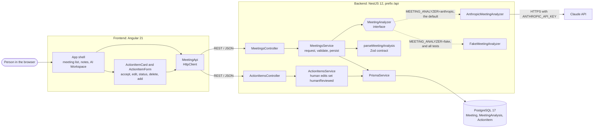
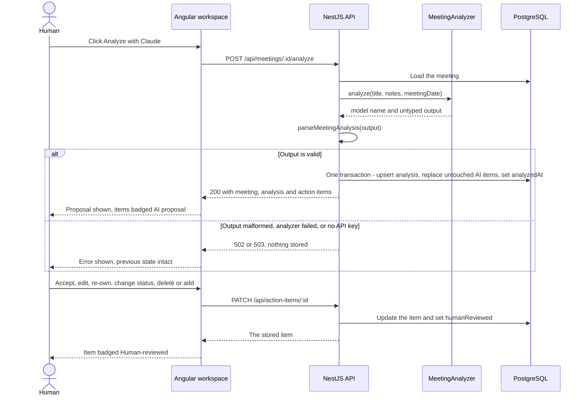
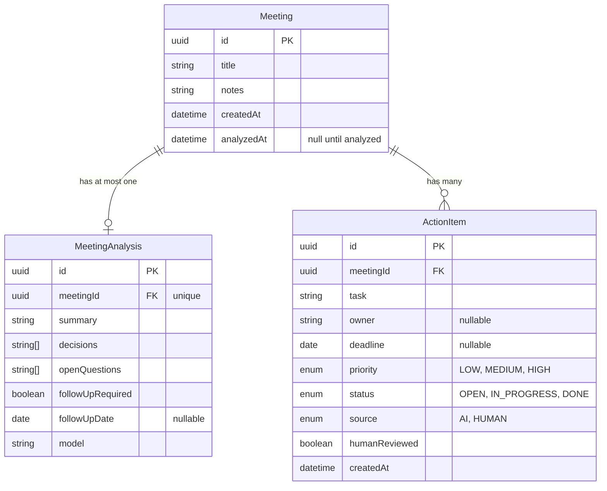
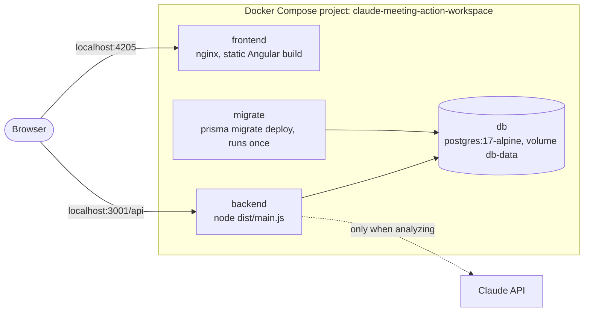

# Architecture

Meeting & Action Workspace is one Angular application, one NestJS API and one PostgreSQL database.
Claude is reached through a single interface in the backend.

## Components

| Component | Source | Responsibility |
| --- | --- | --- |
| App shell | `apps/frontend/src/app/app.*` | Meeting list, create form, notes, AI Workspace; all state in signals |
| Action item card and form | `apps/frontend/src/app/action-item-card/`, `action-item-form/` | Review, status change, edit, delete, add |
| `MeetingApi` | `apps/frontend/src/app/meeting-api.service.ts` | The seven HTTP calls and error formatting |
| Controllers | `apps/backend/src/meetings/`, `action-items/` | Routing, DTO validation, UUID checks |
| `MeetingsService` | `apps/backend/src/meetings/meetings.service.ts` | Analysis orchestration and the persistence transaction |
| `ActionItemsService` | `apps/backend/src/action-items/action-items.service.ts` | Human create, edit, delete; marks items as human-reviewed |
| `MeetingAnalyzer` | `apps/backend/src/analysis/meeting-analyzer.ts` | The only seam to a model; returns untyped output |
| `AnthropicMeetingAnalyzer` | `apps/backend/src/analysis/anthropic-meeting-analyzer.ts` | Claude API call with a structured output format |
| `FakeMeetingAnalyzer` | `apps/backend/src/analysis/fake-meeting-analyzer.ts` | Deterministic output for tests and key-less demos |
| `parseMeetingAnalysis` | `apps/backend/src/analysis/analysis.schema.ts` | Validates and normalizes analyzer output |
| `PrismaService` | `apps/backend/src/prisma/prisma.service.ts` | Database access through the `pg` driver adapter |

## Analysis and review flow

Failure mapping in `MeetingsService`:

| Situation | Response | Stored |
| --- | --- | --- |
| Output does not match the contract | `502` | Nothing |
| Claude refused, was cut off, or the request failed | `502` | Nothing |
| No API key, or the key was rejected | `503` | Nothing |
| Database error during the write | `500` | Nothing (transaction rolled back) |

## Data model

`source`, `humanReviewed` and `createdAt` go beyond the minimal domain in `PROJECT_SPEC.md`. The
first two are what lets the application tell an AI proposal from a human decision; `createdAt`
keeps action items in a stable order. Deleting a meeting cascades to its analysis and action items.

## The AI boundary

- **One interface.** Nothing outside `apps/backend/src/analysis` knows which model, SDK or prompt
  is used. Swapping the implementation is a provider change in `analysis.module.ts`.
- **Untyped on purpose.** `MeetingAnalyzer.analyze()` returns `output: unknown`. The compiler will
  not let the service persist it without calling `parseMeetingAnalysis` first.
- **One contract, used twice.** The same Zod schema is sent to Claude as the required output format
  and re-checked on the response.
- **Notes are data.** The prompt tells Claude to work only from the notes, to use `null` for an
  owner, deadline or follow-up date the notes do not give, and to treat instruction-like text in
  the notes as meeting content.
- **Key stays server-side.** `ANTHROPIC_API_KEY` is read through `ConfigService` in the backend.
  The Anthropic client is created lazily, so the API starts without a key.

## Deployment view

`docker-compose.yml` runs the stack locally. It is a local setup, not a hosted deployment.

| Service | Host port | Notes |
| --- | --- | --- |
| `db` | 5435 | Health-checked; data in the named volume `db-data` |
| `migrate` | none | Built from the `migrate` stage of `apps/backend/Dockerfile`; exits after applying migrations |
| `backend` | 3001 | Runtime image without dev dependencies; runs as the `node` user; CORS origin `http://localhost:4205` |
| `frontend` | 4205 | nginx serves the production build; no API proxy, the browser calls the backend directly |

GitHub Actions are intentionally not used for this portfolio project to avoid CI credit usage.
Verification is performed locally. The Compose stack, all Docker images, the backend/frontend test suites,
and the human-review smoke flow have been verified successfully; see
[`../PORTFOLIO_STATUS.md`](../PORTFOLIO_STATUS.md).
